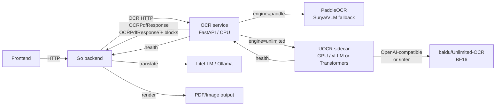

# Unlimited OCR — Integration Plan for LokLingo

**Status:** Implementation in progress. See `docs/reports/unlimited-ocr/` for the current
verified state; the real model serving and quality gates are still pending.
**Date:** 2026-11-03.
**Research basis:** [`../research/unlimited-ocr.md`](../research/unlimited-ocr.md).
**Target:** Add Baidu Unlimited OCR as an optional document-parsing provider without
changing LokLingo's default OCR behavior or breaking existing API contracts.

---

## 1. Goal and non-goals

### Goal

Add a locally hosted, MIT-licensed document-parsing capability that can:

- Parse scanned or image-only PDFs into structured text with layout, tables,
  formulas, reading order, and heading metadata.
- Process multiple pages in one model request, reducing page-by-page fragmentation.
- Return bounding boxes for image overlay translation.
- Run alongside the existing PaddleOCR path with automatic fallback.
- Be enabled per request or per deployment, with no change for users who do not opt
  in.

### Non-goals

- Do not make Unlimited OCR the default OCR engine in the first release.
- Do not remove PaddleOCR, Surya, the Ollama VLM fallback, or the correction pipeline.
- Do not claim calibrated confidence for Unlimited OCR output.
- Do not support Unlimited OCR 2 in production until its serving path is validated
  on this host.
- Do not change the frontend's default OCR behavior in Phase 1.
- Do not commit model weights, custom wheels, or generated reports to Git.

---

## 2. Decision summary

**Chosen architecture:** a separate GPU inference sidecar (`loklingo-ocr-vlm`) plus an
engine adapter inside the existing OCR service.

```
Frontend / Go backend
        │
        ▼
OCR service (FastAPI, CPU) ── engine=paddle ──► PaddleOCR (existing)
        │
        └── engine=unlimited ──► loklingo-ocr-vlm (GPU)
                                  ├─ Phase 1: Transformers inference server
                                  └─ Phase 1b: vLLM, if SM121 smoke test passes
```

**Why this shape:**

1. **Dependency isolation.** PaddleOCR/PaddlePaddle and PyTorch/CUDA do not need to
   coexist in one image. The existing OCR image stays small and CPU-only.
2. **Independent lifecycle.** The model can load, restart, or be upgraded without
   taking down the OCR service. The OCR service can start without it.
3. **Normalization in one place.** The OCR service already renders PDFs and owns the
   `OCRPdfResponse`/`OCRImageResponse` schemas. It is the right place to parse
   `<PAGE>`/`<|det|>` output, scale bboxes, and produce `TextBlock`s.
4. **Real fallback.** The OCR service can fall back to Paddle internally; the backend
   can fall back at the HTTP/provider level if the OCR service fails.
5. **No Go parser.** The backend does not need PyMuPDF or a VLM output parser.

**Initial model:** Unlimited OCR 1 (`baidu/Unlimited-OCR`), because its Transformers
path is known to work on the GB10/SM121 host. Unlimited OCR 2 is a later evaluation.

**Serving backend:** Phase 1 spike compares the official vLLM arm64 image against a
thin Transformers FastAPI wrapper. Use whichever passes the SM121 smoke test and
meets latency/quality targets. Do **not** use SGLang on this host until its
`sgl_kernel` supports SM121.

---

## 3. Prerequisites

Complete these before writing production code.

### 3.1 Environment and access

- [ ] Confirm GPU passthrough works for the Docker daemon:
      `docker run --rm --gpus all nvidia/cuda:13.0.0-base-ubuntu24.04 nvidia-smi -L`.
      Verified on 2026-11-03: returns `GPU 0: NVIDIA GB10`.
- [ ] Confirm free disk for model cache: at least **20 GB** per model generation.
- [ ] Confirm Hugging Face access for the initial download; plan an offline mirror for
      air-gapped deployments.
- [ ] Pin the model revision (commit SHA), the SGLang/vLLM image digest (if used), and
      the model-code checksum. Do not deploy a mutable `main`.
- [ ] Review the MIT license and third-party notices (DeepSeek-OCR, DeepSeek-OCR-2,
      PaddleOCR, vendored kernels). Create `THIRD_PARTY_NOTICES` if not already present.
- [ ] Decide whether the GPU may be shared with Ollama/LiteLLM. Document the
      contention policy; do not let the OCR sidecar starve translation.

### 3.2 Baseline measurement

- [ ] Build a golden corpus of **20–50 pages per target language**, covering:
      English, German, French, Spanish, Chinese, Japanese, Korean, Hindi, Urdu,
      Arabic, Bengali, and at least one mixed-script document.
- [ ] Include document types: clean digital PDF, scanned PDF, two-column paper,
      invoice/table-heavy page, formula-heavy page, form, and a 100+ page report.
- [ ] Record the current PaddleOCR baseline: CER/WER, table TEDS, reading-order edit
      distance, heading accuracy (manual or heuristic), p50/p95 latency, memory, and
      failure rate.
- [ ] Store fixtures and reports under `docs/reports/` and a test-data directory that
      is not committed if it contains sensitive documents.

### 3.3 Product decisions

- [ ] Choose the initial language allowlist. Default recommendation: **empty**
      (feature off) until evaluated; then enable only languages where UOCR meets the
      quality gate. Do not assume Arabic/Indic parity.
- [ ] Choose the confidence representation:
      - **Recommended:** `confidence = 0.0` plus explicit `quality` metadata
        (`engine`, `page_markers_ok`, `truncated`, `repetition_ratio`,
        `page_count_match`). Do not fabricate a confidence score.
      - Alternative: a calibrated proxy after Phase 5 evaluation.
- [ ] Choose whether LLM post-correction applies to UOCR output. Default: **off**;
      VLM output is already generated text, and a small corrector can degrade it.
- [ ] Decide the first user-facing entry point: `ocr_only` PDF jobs first; image
      overlay and PDF layout later.

---

## 4. Target architecture

### 4.1 Components

| Component | Responsibility | Changes |
| --- | --- | --- |
| Frontend | Upload, job progress, result display, optional engine/quality badge | Optional; no required change in Phase 1 |
| Go backend | Job orchestration, provider chain, translation, rendering | Add `unlimited` provider and engine routing; keep API compatible |
| OCR service (`ocr-service`) | PDF rendering, engine dispatch, output normalization, fallback | Add `engine` field, UOCR adapter, parser, quality metadata |
| UOCR sidecar (`ocr-vlm`, new) | Load model, serve inference, health/readiness, page windows | New service |
| Redis/Postgres | Queue/job state (unchanged) | None |
| Shared volume | PDF uploads and model cache | Add model-cache volume |
| GPU | One NVIDIA GPU, BF16 | Sidecar reservation; OCR service stays CPU |

### 4.2 Architecture diagram



### 4.3 Why not the alternatives

| Alternative | Problem |
| --- | --- |
| Put the model inside `ocr-service` | Paddle + PyTorch dependency conflict; huge image; model reload on OCR restart; no batching |
| Call the sidecar directly from Go | Duplicate PDF rendering and `<|det|>` parsing in Go; harder to test |
| Replace Paddle with UOCR | Language coverage unproven; no confidence; loses fast CPU path |
| Use SGLang on GB10 now | Known SM121 `sgl_kernel` failure; custom wheel risk |

---

## 5. Data flow

### 5.1 PDF `ocr_only` (first target)

```
POST /api/v1/jobs {type: translate_pdf, mode: ocr_only, ocr_engine: unlimited}
  → worker.process
    → extractOCRPagesAndConfidence
      → OCRClient.ExtractPagesWithConfidenceAndOptions(engine=unlimited)
        → POST /api/v1/ocr/pdf {engine: "unlimited", lang, dpi, max_pages}
          → OCR service renders pages to images (PyMuPDF/pdf2image)
          → UOCR adapter builds page windows
          → UOCR sidecar returns raw Markdown + <PAGE> + <|det|>
          → parser/normalizer produces PageResult[] + TextBlock[]
          → quality metadata + optional Paddle fallback
        ← OCRPdfResponse
    → job.Text = pages joined
    → job.ProcessingMethod = "ocr"
    → job.OCRConfidence = 0 (or calibrated proxy)
    → complete
```

### 5.2 PDF translation with OCR fallback

```
PDF job (overlay/layout)
  → native PDF text extraction (pdfService.ExtractPages)
    ├─ non-empty → pages = native text (unchanged)
    └─ empty/failed → OCR fallback
         → engine selection: unlimited (if enabled/allowed) else paddle
         → UOCR adapter
         → pages → translation loop → PDF output
```

Phase 1 should not force OCR when native text exists. Add `force_ocr` only after the
`ocr_only` path is proven, so users can compare on the same PDF.

### 5.3 Image overlay translation

```
POST /api/v1/jobs {type: translate_image, ocr_engine: unlimited}
  → worker.process
    → ExtractImageBlocksWithOptions(engine=unlimited)
      → POST /api/v1/ocr {engine: "unlimited", mode: "layout"}
        → single-image Gundam mode (crop_mode=True)
        → parser → TextBlock[] with bboxes
    → translate each block
    → overlay/layout render
```

For image jobs, bbox quality is essential. If the parser cannot produce valid boxes
for a page, the adapter must fall back to Paddle rather than render a full-page block.

### 5.4 Failure and fallback path

```
UOCR request
  ├─ timeout / connection error / HTTP 5xx
  │    → OCR service logs unlimited_unavailable
  │    → if OCR_UNLIMITED_FALLBACK_TO_PADDLE=true: run Paddle path
  │    → response metadata engine=paddle, fallback_from=unlimited
  ├─ HTTP 200 but page count mismatch / empty text / repetition
  │    → mark quality flags
  │    → if page loss: retry once with a larger page window or fallback
  ├─ HTTP 200 but bbox invalid (image jobs)
  │    → fallback to Paddle for that page/job
  └─ OCR service itself unreachable
       → backend provider chain falls back to paddle provider
```

Avoid double fallback loops: the OCR service owns model-level fallback; the backend
chain owns service-level fallback. Record both in metadata.

---

## 6. API and configuration changes

### 6.1 OCR service request additions

Add `engine` to `OCRImageRequest` and `OCRPdfRequest`:

```json
{
  "engine": "paddle | unlimited | auto",
  "lang": "auto",
  "dpi": 200,
  "max_pages": 200,
  "mode": "overlay",
  "ocr_correction_enabled": false,
  "force_ocr": false
}
```

- Default `engine` is `paddle` to preserve behavior.
- `auto` means: use `unlimited` only if enabled and the language is allowlisted;
  otherwise `paddle`. Do not make `auto` the default in the first release.
- Multipart requests accept `engine` as a form field.
- `force_ocr` is only meaningful for PDF translation jobs; it is ignored by
  `ocr_only` (which always OCRs).

### 6.2 OCR service response additions

Keep existing fields; add optional metadata:

```json
{
  "text": "...",
  "confidence": 0.0,
  "pages": [
    {
      "page_number": 1,
      "text": "...",
      "confidence": 0.0,
      "blocks": [
        {
          "text": "...",
          "bbox": [45.0, 100.0, 500.0, 140.0],
          "confidence": 0.0,
          "reading_order": 1,
          "region_class": "body",
          "hierarchy_level": 0,
          "column_id": 0
        }
      ],
      "engine": "unlimited",
      "quality": {
        "page_marker_ok": true,
        "page_count_match": true,
        "truncated": false,
        "repetition_ratio": 0.0,
        "bbox_coordinate_space": "normalized_0_999"
      }
    }
  ],
  "engine": "unlimited",
  "engine_version": "baidu/Unlimited-OCR@<revision>",
  "fallback_from": null,
  "warnings": []
}
```

Compatibility: existing clients ignore unknown fields. Do not remove or rename
existing fields. If the frontend's `TextBlock` type is extended, add optional fields
only. The Go `ocrPDFResponse`/`ocrPageResult` structs must add optional `Engine`,
`EngineVersion`, `Quality`, `Warnings`, and `FallbackFrom` fields so the provider
chain can report the engine that actually produced the result rather than the engine
that was requested.

### 6.3 Configuration

**OCR service variables** (read by `ocr-service`):

| Env var | Default | Purpose |
| --- | --- | --- |
| `OCR_UNLIMITED_ENABLED` | `false` | Feature flag; if false, `engine=unlimited` returns 503 or falls back |
| `OCR_UNLIMITED_BASE_URL` | `http://loklingo-ocr-vlm:10000` | Sidecar base URL |
| `OCR_UNLIMITED_MODEL` | `baidu/Unlimited-OCR` | Model identifier |
| `OCR_UNLIMITED_BACKEND` | `transformers` | `transformers` or `vllm` |
| `OCR_UNLIMITED_TIMEOUT_SECONDS` | `600` | Long-document request timeout |
| `OCR_UNLIMITED_MAX_PAGES_PER_REQUEST` | `10` | Page window size for v1 32K context |
| `OCR_UNLIMITED_PAGE_OVERLAP` | `1` | Overlap pages between windows |
| `OCR_UNLIMITED_LANGS` | empty | Allowlist; empty means no automatic routing |
| `OCR_UNLIMITED_FALLBACK_TO_PADDLE` | `true` | Internal fallback |
| `OCR_UNLIMITED_CONFIDENCE` | `0.0` | 0 means unknown; do not fabricate |
| `OCR_UNLIMITED_CORRECTION` | `false` | Disable LLM correction for VLM output |
| `OCR_UNLIMITED_DPI` | `200` | Render DPI for PDF pages |
| `OCR_UNLIMITED_MAX_OUTPUT_TOKENS_PER_PAGE` | `20000` | v2-style page cap; for v1 use context math |

**Backend variables** (read by `backend/config/config.go`):

| Env var | Default | Purpose |
| --- | --- | --- |
| `OCR_PROVIDER` | `paddle` | Add `unlimited` to the allowed set |
| `OCR_PROVIDER_TIMEOUT_SECONDS` | `120` | Keep for Paddle |
| `OCR_UNLIMITED_PROVIDER_TIMEOUT_SECONDS` | `900` | Backend HTTP timeout when the OCR service uses UOCR |
| `OCR_MAX_FALLBACKS` | `2` | Keep |

Provider-specific timeouts require a small change to
`OCRClientChainOptions` (map of provider → timeout). Do not raise the global timeout
for Paddle; a 200-page Paddle job should still fail over rather than hang for 15
minutes.

### 6.4 Compose changes

Add an optional service, not a required dependency for the default stack:

```yaml
services:
  loklingo-ocr-vlm:
    profiles: ["ocr-vlm"]
    build:
      context: ./ocr-vlm
    container_name: loklingo-ocr-vlm
    restart: unless-stopped
    environment:
      MODEL_ID: "${OCR_UNLIMITED_MODEL:-baidu/Unlimited-OCR}"
      MODEL_REVISION: "${OCR_UNLIMITED_MODEL_REVISION:?pin a revision}"
      HF_HOME: "/models/huggingface"
      TRANSFORMERS_OFFLINE: "${OCR_UNLIMITED_OFFLINE:-0}"
      OCR_VLM_BACKEND: "${OCR_UNLIMITED_BACKEND:-transformers}"
    volumes:
      - uocr_models:/models
    # No host port: only reachable on loklingo-net.
    deploy:
      resources:
        reservations:
          devices:
            - driver: nvidia
              count: 1
              capabilities: [gpu]
    healthcheck:
      test: ["CMD", "python", "-c", "import urllib.request; urllib.request.urlopen('http://localhost:10000/health')"]
      interval: 30s
      timeout: 10s
      retries: 5
      start_period: 300s
    networks:
      - loklingo-net
```

Add `uocr_models:` to the top-level volumes. The OCR service should **not** use
`depends_on: condition: service_healthy` for the optional sidecar; it must start and
serve Paddle even if UOCR is warming or absent. Add `OCR_UNLIMITED_BASE_URL` to the
OCR service environment.

For production, decide whether the profile is enabled by default. Recommendation:
off by default; enable with `docker compose --profile ocr-vlm up`.

---

## 7. Output normalization design

### 7.1 Parser stages

1. **Decode response.** Support both OpenAI-compatible JSON (`choices[0].message.content`)
   and a thin Transformers server's `{text, token_count, ...}` shape.
2. **Split pages.** Split on `<PAGE>`. If no marker exists:
   - For a single-page request, treat the whole output as page 1.
   - For a multi-page request, mark `page_marker_ok=false` and fall back to
     per-window page assignment. Do not guess boundaries inside a window.
3. **Parse blocks.** Recognize:
   - `<|ref|>label<|/ref|><|det|>[[x1,y1,x2,y2]]<|/det|>content`
   - `<|det|>label [x1,y1,x2,y2]<|/det|>content`
   - multiple boxes: `[[...],[...]]`
   Strip the markers from the text; preserve line breaks inside a block.
4. **Classify labels.** Map model labels to LokLingo `region_class`:
   - `title` → `title`, hierarchy 1
   - `heading`/`section` → `heading`, hierarchy 2
   - `subheading` → `subheading`, hierarchy 3
   - `table` → `table`
   - `formula`/`equation` → `formula` (extend the allowed description; keep string)
   - `image`/`figure` → `figure` (do not translate the image; keep caption text if
     present)
   - `header`/`footer`/`page_number` → `annotation` or new `page_header`/`page_footer`
   - `text`/`paragraph`/unknown → `body`
5. **Scale boxes.** Parse numbers as floats. Scale `x / 999 * page_width`,
   `y / 999 * page_height`. Clamp to `[0, width]`/`[0, height]`. Reject
   non-finite, zero-area, or inverted boxes. If a page has no valid boxes for image
   mode, mark the page for fallback.
6. **Order and columns.** Use model order as `reading_order` (1-based). Keep
   `column_id=0` unless a deterministic column heuristic is applied. Do not reorder
   table rows by y-coordinate; tables are Markdown blocks.
7. **Page count guard.** If output pages < input pages, fill missing pages with empty
   `PageResult` and `quality.page_count_match=false`. If output pages > input pages,
   truncate and flag. For v2, rely on the model's `page_count_guard` and still verify.
8. **Quality flags.** Compute:
   - `page_marker_ok`
   - `page_count_match`
   - `truncated` (finish reason / token cap)
   - `repetition_ratio` (max repeated n-gram ratio, e.g. 35-gram)
   - `empty_page_count`
   - `bbox_invalid_count`
   - `markup_leak` (does plain text still contain `<|...|>`?)
9. **Plain text.** Join block texts with blank lines between blocks, preserving
   table Markdown and formula text. Do not include `image` crop links in the
   translatable text unless the user explicitly wants figure captions.

### 7.2 Bounding-box example

Raw: `<|det|>text [45, 100, 500, 140]<|/det|>Hello`

Page rendered at 1700×2200 px:

```
x1 = 45/999*1700 = 76.6
y1 = 100/999*2200 = 220.2
x2 = 500/999*1700 = 850.9
y2 = 140/999*2200 = 308.3
```

Store `[76.6, 220.2, 850.9, 308.3]` in `OCRTextBlock.bbox`.

### 7.3 Confidence policy

Unlimited OCR does not emit calibrated confidence. Options:

| Option | Behavior | Recommendation |
| --- | --- | --- |
| `0.0` + quality metadata | Downstream warnings skip zero confidence (current code only warns when `>0`), frontend hides confidence | **Use initially** |
| Fixed `0.9` | Looks confident, but is fabricated | Do not use |
| Completeness proxy | Map page count, empty pages, repetition, bbox validity to 0.5–0.95 | Only after calibration against human labels |
| Token logprobs | Request logprobs from vLLM, average over content tokens | Research only; special tokens and long outputs complicate calibration |

If the product requires a confidence number, implement the proxy in Phase 5 and
document its meaning. Never present it as model confidence without calibration.

---

## 8. Implementation phases

Each phase is independently reviewable. Do not skip Phase 0/1; they answer the
questions that determine whether later phases are worth building.

### Phase 0 — Evaluation harness and baseline (no production code)

**Objective:** establish whether UOCR is better than the current OCR path on our
documents and languages.

Tasks:

1. Add a fixtures directory and evaluation manifest:
   `docs/reports/unlimited-ocr/` for reports, `ocr-service/eval-data/` (gitignored
   if sensitive) for images and ground truth.
2. Extend `ocr-service/eval_ocr.py` (or add `ocr-service/eval_unlimited.py`) to
   compute CER/WER, table TEDS, formula CDM, reading-order edit distance, heading
   accuracy, latency, and memory.
3. Run the current PaddleOCR baseline on the corpus.
4. Run UOCR through a temporary Transformers script (no service) on the same corpus.
5. Write `docs/reports/unlimited-ocr/phase0-baseline.md` with per-language results and
   a go/no-go recommendation.

**Acceptance:** a reproducible report with per-language metrics; no change to
production code.

### Phase 1 — Sidecar serving spike

**Objective:** choose the serving backend for this host and prove it can serve OCR
requests reliably.

Tasks:

1. Create `ocr-vlm/` with a minimal FastAPI wrapper around the model's
   `infer`/`infer_multi`:
   - `GET /health` (model loaded, device, revision)
   - `POST /infer` (page images, prompt, max tokens)
   - process-wide lock or a single-worker queue; document concurrency limits
   - graceful shutdown
2. Build a container with pinned Python/torch/transformers versions, non-root user,
   `HF_HOME` cache, and model revision.
3. Smoke-test the official vLLM arm64 image:
   `vllm/vllm-openai:unlimited-ocr` with `--trust-remote-code`,
   `NGramPerReqLogitsProcessor`, `--no-enable-prefix-caching`,
   `--mm-processor-cache-gb 0`.
4. Measure cold start, steady VRAM, TPS, and p50/p95 per page for 1, 10, 20, 40, and
   100 pages.
5. Decide: Transformers wrapper, vLLM, or both (vLLM primary, Transformers fallback).
6. Write `docs/reports/unlimited-ocr/phase1-serving.md`.

**Acceptance:** one backend serves a 10-page PDF and a single image on this host;
health check passes; memory is stable; the chosen backend is documented. If neither
backend works, stop and report before building the adapter.

### Phase 2 — OCR service adapter and parser

**Objective:** make the OCR service able to call UOCR and normalize its output.

Tasks:

1. Add `ocr-service/unlimited_ocr.py` (do not grow `app.py` further):
   - `UnlimitedOCRClient` (HTTP, timeout, retry, health)
   - `UnlimitedOCREngine` (PDF/image dispatch)
   - page-window planner
   - response parser and bbox scaler
   - quality metrics
2. Add `engine` to `OCRImageRequest`, `OCRPdfRequest`, and multipart parsing in
   `app.py`.
3. Wire PDF rendering: reuse existing `pdf2image`/PyMuPDF path; render at
   `OCR_UNLIMITED_DPI` (default 200); pass page images in order.
4. Wire single-image path: Gundam mode (`crop_mode=True`, `image_size=640`) for
   detail; Base mode for multi-page.
5. Implement parser fixtures:
   - normal single-page output
   - multi-page `<PAGE>` output
   - `<|ref|>/<|det|>` and direct `<|det|>`
   - multiple boxes per label
   - missing page markers
   - malformed/truncated JSON
   - repeated n-grams
   - image/figure labels
6. Implement internal fallback to Paddle when UOCR fails and
   `OCR_UNLIMITED_FALLBACK_TO_PADDLE=true`.
7. Add `GET /health` fields: `unlimited_enabled`, `unlimited_model`,
   `unlimited_backend`, `unlimited_ready`, `unlimited_last_error`.

**Acceptance:** unit tests cover the parser and page guard; a recorded fixture can be
normalized without a GPU; `/api/v1/ocr/pdf` returns the existing schema plus optional
metadata; `engine=paddle` behavior is unchanged.

### Phase 3 — Backend provider and engine routing

**Objective:** make the Go backend able to select the UOCR engine and fall back
correctly.

Tasks:

1. Add `OCRProviderUnlimited = "unlimited"` and include it in
   `normalizeOCRProvider`/`providerOrder`.
2. Add `Engine` to `OCRRequest` and `OCRRequestOptions`; thread it through
   `ExtractPagesWithConfidenceAndOptions`, `ExtractImageBlocksWithOptions`, and the
   shared-path/multipart/JSON request builders.
3. Add `NewUnlimitedOCRProvider` that uses the same `OCRClient` but sets
   `engine=unlimited`.
4. Add provider-specific timeouts: `OCR_UNLIMITED_PROVIDER_TIMEOUT_SECONDS`.
5. Update `config.Validate()` to accept `unlimited` and validate the new env vars.
6. Add `ocr_engine` to job creation (optional) and `force_ocr` for PDFs; default
   empty/paddle.
7. Ensure the provider chain records the actual engine from the response metadata,
   not just the requested provider name.
8. Add tests: provider order, engine propagation, timeout selection, fallback on
   HTTP 5xx, fallback on empty/invalid response.

**Acceptance:** `OCR_PROVIDER=unlimited` routes PDF/image jobs through the sidecar;
`OCR_PROVIDER=paddle` is byte-compatible with current behavior; fallback tests pass.

### Phase 4 — Deployment and configuration

**Objective:** make the sidecar deployable and operable without breaking the default
stack.

Tasks:

1. Add `ocr-vlm` service to `docker-compose.yml` under the `ocr-vlm` profile; add
   the model-cache volume.
2. Add the same service to `docker-compose.prod.yml` with production resource limits,
   logging, and restart policy.
3. Add `OCR_UNLIMITED_*` variables to `.env.example`, `.env.development`, and
   `.env.production` (feature flag off by default).
4. Keep the sidecar off the host port; only `loklingo-net`.
5. Add health checks and startup ordering that does not block Paddle.
6. Update `README.md` and `guide/API.md` with the optional profile and env vars.
7. Add a runbook section to `guide/reliability-runbook.md`: start/stop, model cache
   refresh, OOM recovery, fallback verification.

**Acceptance:** `docker compose up` works with the profile off; with the profile on,
the sidecar becomes healthy and the OCR service can route to it; default stack
startup time is unchanged.

### Phase 5 — Quality calibration and language allowlist

**Objective:** decide where UOCR is allowed to run automatically.

Tasks:

1. Run the Phase 0 harness against the deployed sidecar for every target language.
2. Compare CER/WER, table TEDS, reading order, and heading accuracy against Paddle.
3. Set `OCR_UNLIMITED_LANGS` to languages that meet the gate (e.g. no more than
   +1.0 percentage point CER regression; table/layout docs must improve).
4. Decide confidence proxy or keep `0.0` + quality metadata.
5. Decide correction policy; keep it off unless eval proves a gain.
6. Write `docs/reports/unlimited-ocr/phase5-quality.md` and update the plan.

**Acceptance:** an explicit allowlist and quality gate documented; unsupported
languages route to Paddle; no user-visible confidence fabrication.

### Phase 6 — Long-document chunking and OCR 2 evaluation

**Objective:** handle PDFs longer than the v1 context and decide whether OCR 2 is
worth adopting.

Tasks:

1. Implement page-window planning for v1:
   - `pages_per_window` from context budget (start at 8–10 pages; measure).
   - one-page overlap; merge by absolute page index; do not duplicate the overlap
     page.
   - per-window timeout and partial-failure handling.
2. Test 40, 100, and 200-page PDFs; measure page-count match, repetition,
   latency, and memory.
3. Evaluate Unlimited OCR 2 in a separate branch/container:
   - Transformers native path on SM121 (sparse/DASH Triton kernels).
   - SGLang custom wheel only if `sgl_kernel` supports SM121 or is recompiled.
   - Compare 100–300-page quality and throughput against v1 chunking.
4. Write `docs/reports/unlimited-ocr/phase6-long-docs.md` with a recommendation.

**Acceptance:** long PDFs either succeed with documented quality/latency or fail
gracefully with a clear fallback; v2 is explicitly go/no-go, not assumed.

### Phase 7 — Observability, hardening, and rollout

**Objective:** operate the feature safely and measure it in production.

Tasks:

1. Add metrics/logs:
   - `ocr_engine_selected{engine}`
   - `ocr_unlimited_pages_total`
   - `ocr_unlimited_page_windows_total`
   - `ocr_unlimited_truncated_pages_total`
   - `ocr_unlimited_repetition_flagged_total`
   - `ocr_unlimited_bbox_invalid_total`
   - `ocr_unlimited_fallback_total{reason}`
   - `ocr_unlimited_latency_ms` histogram
   - `ocr_unlimited_tokens_per_second`
2. Add health/readiness behavior: OCR service reports `unlimited_ready=false` without
   failing; backend dashboard shows degraded, not down.
3. Add alerts for fallback rate, truncation rate, OOM/restart loops, and p95 latency.
4. Harden containers: non-root, read-only rootfs where possible,
   `no-new-privileges`, no public port, pinned images/model revision, SBOM.
5. Run failure injection: kill sidecar, slow response, malformed JSON, OOM, 429/503.
6. Roll out behind `OCR_UNLIMITED_ENABLED=false`; canary a small percentage of
   `ocr_only` jobs; compare metrics; then enable for allowlisted languages.
7. Rollback: set `OCR_PROVIDER=paddle` / `OCR_UNLIMITED_ENABLED=false`; no schema
   migration required.

**Acceptance:** dashboards and alerts exist; fallback is proven; canary shows no
increase in job failures or dead letters; rollback is a config change. Document the
feature in `guide/API.md` and the runbook.

---

## 9. Follow-up agentic coding tasks

Use these IDs in future sessions. Each task is scoped to a fresh context and lists
target files, dependencies, and verification. Do not start a dependent task until its
predecessor's acceptance criteria are met.

### P0 — Must complete before production routing

#### UOCR-01 — Golden corpus and evaluation harness

- **Depends on:** none.
- **Target files:** `ocr-service/eval_ocr.py`, `ocr-service/eval_unlimited.py` (new),
  `docs/reports/unlimited-ocr/`, test fixtures.
- **Work:** add a manifest-driven corpus runner; compute CER/WER, table TEDS,
  formula CDM, reading-order edit distance, heading accuracy, latency, memory; emit
  JSON + Markdown.
- **Verification:** running the harness on Paddle produces a baseline report; fixtures
  are excluded from Git if sensitive; no production imports change.
- **Acceptance:** `docs/reports/unlimited-ocr/phase0-baseline.md` exists with
  per-language numbers.

#### UOCR-02 — Sidecar serving spike (v1)

- **Depends on:** UOCR-01 (for quality comparison), but can start in parallel for
  serving.
- **Target files:** `ocr-vlm/` (new), `docs/reports/unlimited-ocr/phase1-serving.md`.
- **Work:** build a minimal Transformers FastAPI server with `/health` and `/infer`;
  validate the official vLLM arm64 image on SM121; measure cold start, VRAM, TPS,
  and page scaling; choose the backend.
- **Verification:** 10-page PDF and single image succeed; health check passes; no
  OOM; report documents the chosen backend and fallback.
- **Acceptance:** a reproducible container command and measurements.

#### UOCR-03 — OCR service adapter

- **Depends on:** UOCR-02.
- **Target files:** `ocr-service/unlimited_ocr.py` (new), `ocr-service/app.py`,
  `ocr-service/test_unlimited_ocr.py`, `ocr-service/requirements.txt`.
- **Work:** add `engine` request field; implement HTTP client, page-window planner,
  parser, bbox scaler, quality flags, internal Paddle fallback, health fields.
- **Verification:** unit tests for parser/normalizer; `engine=paddle` unchanged;
  recorded fixtures work without a GPU; malformed output never panics.
- **Acceptance:** `/api/v1/ocr/pdf` and `/api/v1/ocr` accept `engine=unlimited` and
  return the existing schema plus optional metadata.

#### UOCR-04 — Backend provider and engine routing

- **Depends on:** UOCR-03.
- **Target files:** `backend/internal/services/ocr_client.go`,
  `backend/internal/services/ocr_provider_chain.go`, `backend/config/config.go`,
  `backend/main.go`, tests.
- **Work:** add `unlimited` provider, `Engine` field, provider-specific timeout,
  config validation, fallback tests, job `ocr_engine`/`force_ocr` fields.
- **Verification:** `go test ./...`; provider order tests; engine propagation tests;
  fallback on HTTP 5xx and empty response; Paddle default unchanged.
- **Acceptance:** a job can select `unlimited` and fall back to `paddle` without
  changing the API response shape.

### P1 — Deployment and quality

#### UOCR-05 — Compose, GPU profile, and configuration

- **Depends on:** UOCR-02, UOCR-03.
- **Target files:** `docker-compose.yml`, `docker-compose.prod.yml`,
  `.env.example`, `.env.development`, `.env.production`, `README.md`.
- **Work:** add optional `ocr-vlm` profile, GPU reservation, model cache, health
  check, env vars, no host port; keep default startup unchanged.
- **Verification:** `docker compose config`; profile-off stack starts; profile-on
  sidecar becomes healthy.
- **Acceptance:** documented one-command opt-in and rollback.

#### UOCR-06 — API/UI opt-in and quality display

- **Depends on:** UOCR-04, UOCR-05.
- **Target files:** `backend/handlers/jobs.go`, `frontend/src/api/ocr.ts`,
  `frontend/src/App.tsx`, `frontend/src/PdfJobsPanel.tsx`, e2e tests.
- **Work:** expose optional `ocr_engine` on job creation; show engine/quality badge;
  show "quality unknown" instead of a fake confidence; keep defaults unchanged.
- **Verification:** Playwright uploads a PDF/image with the opt-in and sees the badge;
  existing flows unchanged.
- **Acceptance:** no regression in default UI; opt-in is discoverable but not
  intrusive.

#### UOCR-07 — Quality calibration and allowlist

- **Depends on:** UOCR-01, UOCR-03, UOCR-05.
- **Target files:** config defaults, `docs/reports/unlimited-ocr/phase5-quality.md`.
- **Work:** run the corpus, compare against Paddle, set `OCR_UNLIMITED_LANGS`, decide
  confidence proxy and correction policy.
- **Verification:** report has per-language numbers and explicit gate decisions.
- **Acceptance:** unsupported languages route to Paddle; no fabricated confidence.

#### UOCR-08 — Observability and runbook

- **Depends on:** UOCR-04, UOCR-05.
- **Target files:** `backend/internal/observability/*`, `guide/reliability-runbook.md`,
  `guide/API.md`.
- **Work:** metrics/logs/alerts; health degradation; start/stop, cache refresh, OOM,
  fallback verification.
- **Verification:** metrics appear; alert rules fire in a test; runbook commands work.
- **Acceptance:** operators can diagnose a UOCR failure without reading code.

### P2 — Long documents and hardening

#### UOCR-09 — Long-document page windows

- **Depends on:** UOCR-03, UOCR-07.
- **Target files:** `ocr-service/unlimited_ocr.py`, tests, long-doc fixtures.
- **Work:** page-window planner with overlap and merge; per-window timeout; page
  count guard; partial failure handling.
- **Verification:** 40/100/200-page PDFs; page count match; repetition flags; memory
  stable; fallback on window failure.
- **Acceptance:** documented quality/latency curve; no OOM.

#### UOCR-10 — Unlimited OCR 2 evaluation

- **Depends on:** UOCR-02, UOCR-09.
- **Target files:** `ocr-vlm-v2/` (new, separate), `docs/reports/unlimited-ocr/phase6-long-docs.md`.
- **Work:** validate v2 Transformers on SM121; evaluate SGLang only if kernels
  support SM121; compare 100–300-page quality/throughput against v1 chunking.
- **Verification:** report with go/no-go; no production changes unless approved.
- **Acceptance:** explicit decision with evidence.

#### UOCR-11 — Security and supply-chain hardening

- **Depends on:** UOCR-05.
- **Target files:** Dockerfiles, CI, `THIRD_PARTY_NOTICES`, docs.
- **Work:** pin model/image revisions, review `trust_remote_code` code, non-root,
  read-only rootfs, no public port, SBOM, dependency audit, license notices.
- **Verification:** container scan; no secrets; network policy; model checksum.
- **Acceptance:** security checklist signed off; deployment reproducible offline.

#### UOCR-12 — E2E and failure injection

- **Depends on:** UOCR-04, UOCR-06, UOCR-09.
- **Target files:** `e2e/`, backend/OCR integration tests.
- **Work:** PDF `ocr_only`, image overlay, opt-in UI, kill sidecar, timeout, malformed
  JSON, OOM, 429/503, fallback; assert job completes or dead-letters correctly.
- **Verification:** tests pass in CI; GPU test is nightly/skipped without GPU.
- **Acceptance:** failure matrix covered; no silent data loss.

#### UOCR-13 — Rollout and documentation closeout

- **Depends on:** all UOCR tasks (or explicitly documented exceptions for deferred P2
  work).
- **Target files:** `docs/`, `README.md`, `guide/API.md`, `guide/reliability-runbook.md`.
- **Work:** canary plan, feature flag, rollback, final report, update research doc with
  measured numbers.
- **Verification:** canary metrics; rollback rehearsal.
- **Acceptance:** feature is either default-on for allowlisted languages with evidence,
  or remains opt-in with a clear rationale.

---

## 10. Testing strategy

### 10.1 Unit tests (CPU, no model)

- Parser: `<PAGE>`, `<|ref|>/<|det|>` variants, multiple boxes, labels, missing
  markers, malformed output, empty pages.
- Bbox scaling and validation: normalized 0–999, clamping, inverted/zero-area boxes,
  non-finite values.
- Page count guard: fewer/more output pages, overlap merging.
- Quality flags: truncation, repetition, markup leak, empty page count.
- Engine selection: `paddle`, `unlimited`, `auto`, allowlist, feature flag.
- Fallback: UOCR error → Paddle; Paddle error → backend provider fallback.

### 10.2 Contract tests

- OCR service response remains backward compatible: existing fields present, new
  fields optional.
- Backend `OCRClient` decodes old and new responses.
- Multipart and JSON request paths both carry `engine`.
- Timeouts and retries do not duplicate page output or create fallback loops.

### 10.3 Quality evaluation

- Per-language CER/WER against ground truth.
- Table TEDS and formula CDM for structured pages.
- Reading-order edit distance.
- Heading hierarchy accuracy (manual or heuristic).
- Long-document: 40/100/200 pages, page-count match, repetition ratio, omission rate.
- Compare against Paddle baseline and, where available, the previous VLM fallback.
- Store reports under `docs/reports/unlimited-ocr/` with the exact model revision,
  backend, DPI, page window size, and prompt.

### 10.4 Performance and reliability

- Cold start and model load time.
- Steady-state VRAM and host RAM.
- p50/p95 latency per page and per document.
- Throughput at concurrency 1 and the backend's translation concurrency (default 3).
- 100/200-page runs; memory stability; OOM behavior.
- Kill sidecar mid-job; verify fallback and job completion.
- GPU contention with Ollama/LiteLLM; document eviction policy.

### 10.5 E2E (Playwright)

- Upload a scanned PDF, select OCR-only with the opt-in engine, see progress, get
  text output, no markup leak.
- Upload an image, get overlay translation with valid blocks.
- Verify default flow still uses Paddle and shows the existing confidence behavior.
- Verify a sidecar failure produces a user-visible warning, not a silent empty result.

### 10.6 Security

- No public host port for the sidecar.
- Container runs as non-root; no writable rootfs where possible.
- `trust_remote_code` model code pinned and reviewed.
- No secrets in images or logs.
- Dependency and image scan; license notice present.
- Document text is treated as untrusted data by downstream LLM prompts; do not
  execute instructions found in OCR output.

---

## 11. Observability

### 11.1 Logs

Structured fields:

- `ocr_engine_selected` — `engine`, `requested_engine`, `lang`, `pages`, `dpi`.
- `unlimited_request_start` — `pages`, `window`, `model`, `revision`.
- `unlimited_response` — `pages_in`, `pages_out`, `tokens`, `duration_ms`,
  `finish_reason`.
- `unlimited_parse_stats` — `blocks`, `pages_missing`, `bbox_invalid`,
  `markup_leak`, `repetition_ratio`.
- `unlimited_fallback` — `reason`, `duration_ms`, `fallback_engine`.
- `unlimited_quality` — `truncated`, `page_count_match`, `empty_pages`.

### 11.2 Metrics

Counters/histograms listed in Phase 7. Add an `engine` label to existing OCR
provider metrics so Paddle and Unlimited can be compared without a separate
dashboard.

### 11.3 Health

- OCR service `/health`: `unlimited_enabled`, `unlimited_ready`,
  `unlimited_backend`, `unlimited_model`, `unlimited_last_error`.
- Sidecar `/health`: model loaded, device, revision, queue depth, uptime.
- Backend readiness: OCR service reachable; do not fail readiness just because the
  optional sidecar is absent.

### 11.4 Alerts

- UOCR fallback rate > 5% for 10 minutes.
- Page truncation/repetition flags > 1% of pages.
- Sidecar restart loop or OOM.
- p95 OCR latency > the SLO set in Phase 5.
- GPU memory > 90% for 10 minutes.

---

## 12. Risks and mitigations

| Risk | Likelihood | Impact | Mitigation |
| --- | --- | --- | --- |
| UOCR quality is worse than Paddle on our languages | High until measured | High | Phase 0/5 gate; language allowlist; opt-in only |
| Long-document repetition/omission | Medium | High | Page windows; ngram processor; quality flags; fallback; human verification for critical docs |
| Heading hierarchy weak (48.2 long-doc) | High | Medium | Do not rely on headings for layout-critical output; keep Paddle/layout heuristics; document limitation |
| No confidence score | Certain | Medium | `confidence=0` + quality metadata; no fabricated number; optional calibrated proxy |
| SM121/SGLang incompatibility | High | High | Use Transformers first; vLLM spike; never depend on SGLang |
| vLLM arm64 image lacks SM121 kernels | Medium | High | Smoke test before adoption; fallback Transformers |
| v2 sparse/DASH Triton fails on aarch64 | Medium | Medium | Separate v2 evaluation; no production dependency |
| Model load/cold start blocks startup | Medium | Medium | Optional profile; start without sidecar; `start_period`; health degradation |
| GPU contention with Ollama/LiteLLM | Medium | Medium | GPU reservation; concurrency limits; queueing; monitor |
| OOM on long PDFs | Medium | High | Page windows; context math; max pages; memory limits; fallback |
| bbox parsing/scaling errors | Medium | High for image overlay | Unit tests; validation; fallback to Paddle on invalid boxes |
| Markup leaks into translated text | Medium | High | Parser strips tags; golden tests; `markup_leak` flag |
| Model code supply chain (`trust_remote_code`) | Medium | High | Pin revision; vendor/review code; non-root; no egress; SBOM |
| Custom wheel drift/version mismatch | High | Medium | Pin wheel SHA; separate environments; no `latest` |
| License/third-party notice gaps | Low | Medium | MIT review; `THIRD_PARTY_NOTICES`; legal review before redistribution |
| Extra operational complexity | High | Medium | Optional profile; runbook; health; rollback flag |
| Users expect all languages | Medium | Medium | Clear UI badge/allowlist; fallback messaging |
| Cross-page translation still splits tables | High | Medium | Treat as follow-up; document-level chunking is separate |

---

## 13. Rollout and rollback

### Rollout

1. **Internal only:** deploy sidecar with the profile off by default; run Phase 0/1
   on real documents.
2. **Shadow mode:** call UOCR for a sample of `ocr_only` jobs but return Paddle output;
   compare quality/latency offline. No user-visible change.
3. **Canary:** enable `engine=unlimited` for <10% of `ocr_only` jobs in allowlisted
   languages; monitor fallback, truncation, job success, latency.
4. **Opt-in:** expose the engine selector for advanced users; keep Paddle default.
5. **Default for allowlisted languages:** only after Phase 5 gate and canary show no
   regression; keep Paddle as automatic fallback.
6. **v2:** separate rollout after Phase 6; do not mix with v1 rollout.

### Rollback

- Set `OCR_UNLIMITED_ENABLED=false` (OCR service routes all requests to Paddle).
- Or set `OCR_PROVIDER=paddle` in the backend.
- Stop the `ocr-vlm` profile; the OCR service and backend remain healthy.
- No database migration or response schema removal, so rollback is immediate.

---

## 14. Definition of done

- [ ] A documented, reproducible serving backend for v1 on GB10/SM121.
- [ ] `engine=unlimited` works for PDF and image OCR without changing existing
      clients.
- [ ] Parser/normalizer handles `<PAGE>`, `<|det|>`, bboxes, labels, page guards,
      malformed output, and markup stripping with unit tests.
- [ ] Backend provider chain selects the engine, applies provider-specific timeouts,
      and falls back on failures.
- [ ] Quality report per language and document type; explicit allowlist.
- [ ] Confidence policy documented; no fabricated confidence.
- [ ] Long-document behavior measured at 40/100/200 pages; fallback works.
- [ ] Observability, health, alerts, and runbook exist.
- [ ] Security hardening and license notices complete.
- [ ] E2E and failure-injection tests pass.
- [ ] Rollout/rollback rehearsed; default behavior unchanged until approved.
- [ ] v2 go/no-go decision recorded.

---

## 15. Open questions

1. Which serving backend wins on this host: vLLM arm64 or Transformers? (Phase 1)
2. Does the model emit `<PAGE>` reliably for multi-page requests at the revision we
   pin? (Phase 1)
3. What is the actual per-language quality vs. Paddle? (Phase 0/5)
4. What page-window size/overlap maximizes quality for our 100–200-page PDFs? (Phase 6)
5. Can we calibrate a useful confidence proxy, or should confidence remain unknown?
6. Does LLM correction help or hurt UOCR output? (Phase 5)
7. Is v2's Transformers path viable on SM121, and is it worth the upgrade? (Phase 6)
8. How should the GPU be shared with Ollama/LiteLLM under load? (Phase 4/7)
9. Do we need a document-level translation chunker to preserve cross-page tables?
   (Follow-up, not part of this plan.)
10. What is the license/notice status of the vendored DeepSeek/PaddleOCR code?
    (Phase 4/11)

---

## 16. Appendix A — Raw output fixture and parser expectation

Input (synthetic):

```
<PAGE>
<|ref|>title<|/ref|><|det|>title [40, 30, 960, 90]<|/det|>
Quarterly Report

<|ref|>text<|/ref|><|det|>text [40, 110, 960, 170]<|/det|>
Revenue increased by 12% year over year.

<|det|>table [40, 220, 960, 700]<|/det|>
| Quarter | Revenue |
| --- | --- |
| Q1 | 100 |
| Q2 | 112 |
```

Expected normalized output:

- Page 1 with three blocks:
  - `Quarterly Report`, `region_class=title`, `hierarchy_level=1`,
    `bbox=[40/999*w, 30/999*h, 960/999*w, 90/999*h]`
  - `Revenue increased...`, `region_class=body`, order 2
  - table Markdown, `region_class=table`, order 3
- No `<|ref|>` or `<|det|>` in `text`.
- If the page image is 1700×2200: title bbox ≈ `[68.1, 66.1, 1633.6, 198.2]`.

## 17. Appendix B — Serving smoke-test checklist

```bash
# 1. GPU passthrough
docker run --rm --gpus all nvidia/cuda:13.0.0-base-ubuntu24.04 nvidia-smi -L

# 2. vLLM (v1) — only if the image runs on SM121
docker run --rm --gpus all --network host --ipc host \
  vllm/vllm-openai:unlimited-ocr \
  baidu/Unlimited-OCR \
  --trust-remote-code \
  --logits_processors vllm.model_executor.models.unlimited_ocr:NGramPerReqLogitsProcessor \
  --no-enable-prefix-caching \
  --mm-processor-cache-gb 0

# 3. Health
curl -s http://127.0.0.1:10000/health
curl -s http://127.0.0.1:10000/v1/models

# 4. Single image via OpenAI-compatible API
#    prompt must start with <image>, skip_special_tokens=false,
#    ngram_size=35, window_size=128, temperature=0
```

Record: image digest, model revision, CUDA/driver, torch/transformers versions,
cold-start seconds, VRAM, and first-token latency.

## 18. Appendix C — Evaluation report template

```markdown
# Unlimited OCR — Phase N report

- Date:
- Model: baidu/Unlimited-OCR @ <revision>
- Backend: transformers | vllm
- CUDA / driver:
- DPI:
- Page window / overlap:
- Prompt:
- Correction: off | on

## Corpus
| Language | Documents | Pages | Types |
| --- | ---: | ---: | --- |

## Quality
| Language | Engine | CER ↓ | WER ↓ | Table TEDS ↑ | Formula CDM ↑ | Reading order ↓ | Heading acc ↑ |
| --- | --- | ---: | ---: | ---: | ---: | ---: | ---: |

## Performance
| Pages | p50 latency | p95 latency | Peak VRAM | TPS | Page-count match |
| ---: | ---: | ---: | ---: | ---: | ---: |

## Failures
- Truncation:
- Repetition:
- Empty pages:
- Bbox invalid:
- Fallback reasons:

## Decision
- [ ] Allowlist languages:
- [ ] Keep opt-in / default:
- [ ] Follow-ups:
```

---

## 19. References

Use the research document's source list:
[`../research/unlimited-ocr.md#13-references`](../research/unlimited-ocr.md#13-references).

Key project files for implementation:

- `ocr-service/app.py` — OCR routes, models, PDF rendering, fallback.
- `ocr-service/eval_ocr.py` — existing evaluation harness.
- `backend/internal/services/ocr_client.go` — HTTP client, response schema.
- `backend/internal/services/ocr_provider_chain.go` — provider chain.
- `backend/config/config.go` — env config and validation.
- `backend/jobs/worker.go` — job pipeline and OCR calls.
- `docker-compose.yml`, `docker-compose.prod.yml` — deployment.
- `guide/API.md`, `guide/reliability-runbook.md` — contracts and operations.
